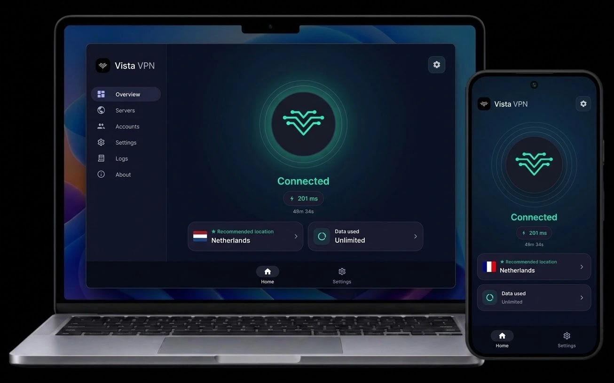
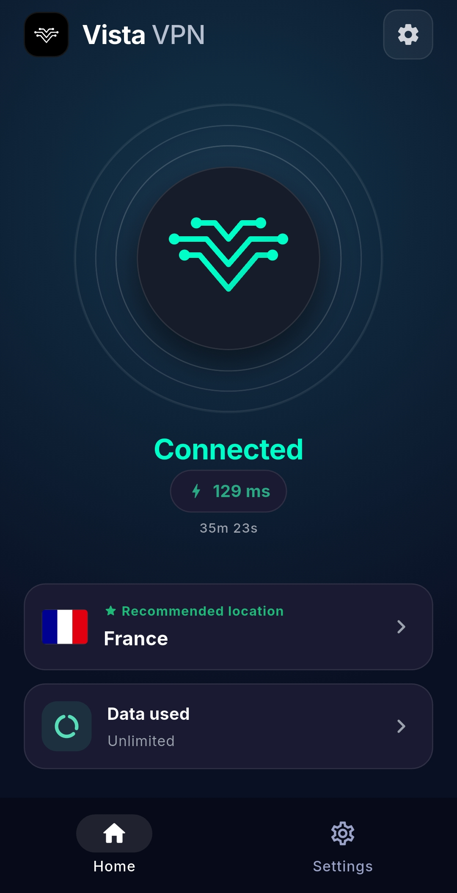
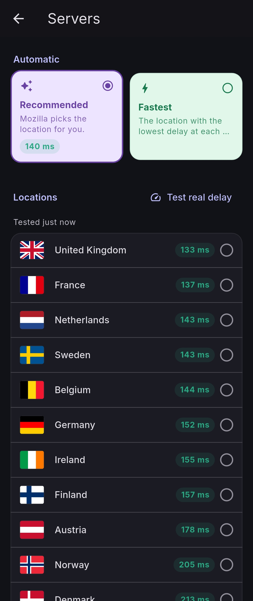
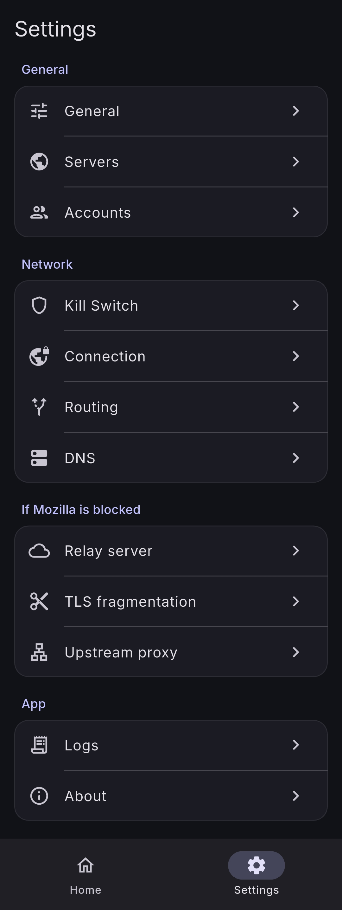
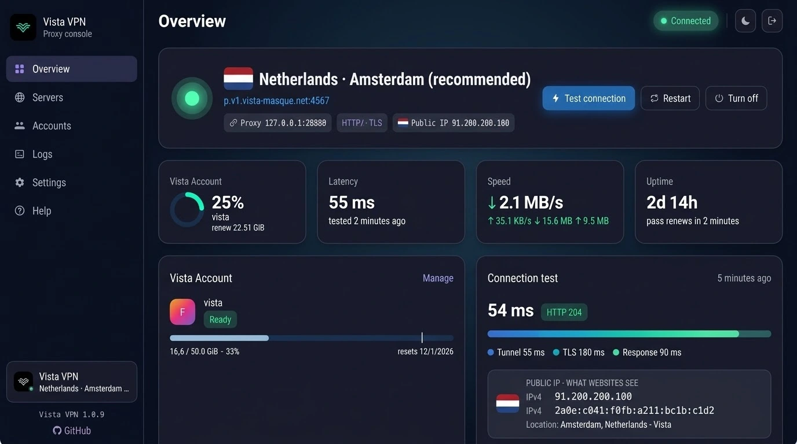

<div align="center">

**English** &nbsp;/&nbsp; [فارسی](docs/readme/README_fa.md)

</div>
<br>

<p align="center"></p>

<h1 align="center">Vista VPN</h1>

<h2 align="center">⚠️ Independent project</h2>

<h3 align="center">Vista VPN is developed independently and is not made, owned, sponsored, or endorsed by Mozilla. It has no official affiliation with Mozilla. Please read the <a href="#disclaimer">disclaimer</a>.</h3>

<div align="center">

[](https://github.com/thisisvista/vista-vpn/releases)
[](https://github.com/thisisvista/vista-vpn/releases/latest)
[](LICENSE)

</div>

## What is Vista VPN?

**Vista VPN** is a free, open-source VPN client for Firefox Accounts. It sends your internet traffic through Mozilla's VPN servers, running on **Fastly** infrastructure, with secure **HTTP/1.1, HTTP/2, and HTTP/3** tunnels.

Available for **Android, Windows, macOS, and Linux** — free to use and without ads.

<p align="center"><a href="https://raw.githubusercontent.com/thisisvista/vista-vpn/main/docs/screenshots/main.webp" target="_blank"></a></p>

## ✨ Features

- **Use it across devices:** available on Android, Windows, macOS, and Linux.
- **Android TV ready:** navigate the app with your remote control.
- **Simple by design:** connection and server controls are easy to find.
- **Monthly data allowance:** 50 GB for each Firefox Account.
- **Flexible server choice:** compare locations by latency or let the app choose a suitable server.
- **Modern connection protocols:** supports HTTP/1.1, HTTP/2, and HTTP/3.
- **Firefox-style TLS:** uses uTLS to begin connections to Mozilla with a Firefox-like TLS fingerprint.
- **Split tunneling:** select the apps and websites that should connect outside the VPN.
- 🛠️ **Tools for restricted networks:** TLS fragmentation, an upstream SOCKS5 proxy, and an optional [relay server](docs/relay/README.md).
- **Move your setup:** back up and restore accounts and settings on another device or server.
- **Connection settings:** choose IPv4, IPv6, or dual-stack mode, and configure a custom MTU.
- **Private DNS requests:** encrypted DNS through DNS over HTTPS.
- **Language options:** 15 languages, including English, Persian, Chinese, and Russian.
- **Light or dark:** switch between the two available themes.
- **Open development:** source code is available for review and contributions.
- **Kill switch (Android):** helps prevent internet traffic from bypassing the VPN if the VPN connection drops. Enabled by default on fresh installs; Android's system-level Always-on VPN and “Block connections without VPN” provide additional protection if the app is stopped.

## 🖼️ Screenshots

<p align="center">
&nbsp;&nbsp;
&nbsp;&nbsp;

</p>

## ⬇️ Downloads

<table>
<thead>
<tr><th>System</th><th>Download</th></tr>
</thead>
<tbody>
<tr><td>Android</td><td><a href="https://github.com/thisisvista/vista-vpn/releases/latest/download/Vista-VPN-Android-universal.apk"></a><br><a href="https://github.com/thisisvista/vista-vpn/releases/latest/download/Vista-VPN-Android-arm64-v8a.apk"></a><br><a href="https://github.com/thisisvista/vista-vpn/releases/latest/download/Vista-VPN-Android-armeabi-v7a.apk"></a><br><a href="https://github.com/thisisvista/vista-vpn/releases/latest/download/Vista-VPN-Android-x86_64.apk"></a></td></tr>
<tr><td>Android TV</td><td><a href="https://github.com/thisisvista/vista-vpn/releases/latest/download/Vista-VPN-Android-universal.apk"></a></td></tr>
<tr><td>Windows</td><td><a href="https://github.com/thisisvista/vista-vpn/releases/latest/download/Vista-VPN-Windows-Setup-x64.exe"></a><br><a href="https://github.com/thisisvista/vista-vpn/releases/latest/download/Vista-VPN-Windows-x64.zip"></a></td></tr>
<tr><td>macOS</td><td><a href="https://github.com/thisisvista/vista-vpn/releases/latest/download/Vista-VPN-macOS.dmg"></a></td></tr>
<tr><td rowspan="2">Linux</td><td><a href="https://github.com/thisisvista/vista-vpn/releases/latest/download/Vista-VPN-Linux-amd64.tar.gz"></a><br><a href="https://github.com/thisisvista/vista-vpn/releases/latest/download/Vista-VPN-Linux-arm64.tar.gz"></a></td></tr>
<tr><td><a href="https://github.com/thisisvista/vista-vpn/releases/latest/download/vista-vpn-core-linux-amd64.tar.gz"></a><br><a href="https://github.com/thisisvista/vista-vpn/releases/latest/download/vista-vpn-core-linux-arm64.tar.gz"></a></td></tr>
</tbody>
</table>

**Not sure which download is right for you?**

- **Android:** Universal works on a wide range of devices. ARMv8 is a smaller option for most newer phones.
- **Windows:** choose Setup for a standard installation, or Portable to run the app without installing it.
- **Linux:** App is intended for desktop systems with a graphical interface; Core is for servers and includes web-panel access.

## 🧰 Linux and macOS installation

> Windows and Android users can skip this section and use the downloads above.

```bash
curl -fsSL https://raw.githubusercontent.com/thisisvista/vista-vpn/main/install.sh | bash
```

### 🌐 Web panel

On Linux servers, Vista VPN includes a browser-based control panel. Use it to manage accounts and data, select servers, check latency, test the connection, view live logs, and adjust settings.

<p align="center"></p>

- **Panel address:** `http://SERVER-IP:10820/app/`. Sign in with the username and password configured during installation; the exact address is displayed when setup finishes.
- **Proxy access:** SOCKS5 and HTTP are available on port `10810`, with separate login details.

### 🖥️ Terminal management

To open the server management menu, run `sudo vista-vpn`:

```text
$ sudo vista-vpn

  Vista VPN
  ────────────────────────────────────────────────────────────────────────────
    Service     ● running
    Autostart   on
  ────────────────────────────────────────────────────────────────────────────
   0) Exit
  ────────────────────────────────────────────────────────────────────────────
   1) Update                                   vista-vpn update
   2) Uninstall                                vista-vpn uninstall
  ────────────────────────────────────────────────────────────────────────────
   3) Set panel login                          vista-vpn panel
   4) View panel info                          vista-vpn panel-info
  ────────────────────────────────────────────────────────────────────────────
   5) Status                                   vista-vpn status
   6) Start                                    vista-vpn start
   7) Stop                                     vista-vpn stop
   8) Restart                                  vista-vpn restart
   9) Show the log                             vista-vpn logs
  ────────────────────────────────────────────────────────────────────────────
  10) Enable autostart                         vista-vpn enable
  11) Disable autostart                        vista-vpn disable
  ────────────────────────────────────────────────────────────────────────────
  12) Add a Firefox Account                    vista-vpn add-account
  13) List the accounts                        vista-vpn list-accounts
  ────────────────────────────────────────────────────────────────────────────
  Enter a number [0-13]:
```

## 📡 OpenWrt routers

For router setup instructions, follow the [OpenWrt guide](docs/OPENWRT.md).

## ⚠️ Known limitations

<details>
<summary>Traffic restrictions on Mozilla's servers</summary>

- **TCP:** only ports 80, 443, 8080, and 8443 are supported. Other ports, including common mail ports (25, 465, 587, 993) and SSH (22), are blocked. Git over SSH to GitHub is an exception because it can use port 443.
- **UDP:** supported ports are 80, 443, 3478, 8080, 8443, and 49152–65534. Calls and games that rely on other ports may not work, while browsers and many everyday apps should work normally.

</details>

## Disclaimer

Vista VPN is an independent, unofficial client maintained by its own developer. It is not a Mozilla product, and Mozilla has no role in its creation, ownership, sponsorship, endorsement, development, or support. Please report questions or issues about this app in this repository rather than contacting Mozilla.

You sign in with your own Mozilla account. Account terms, data limits, and service availability are determined by Mozilla. Your password and sign-in tokens remain on your device.
