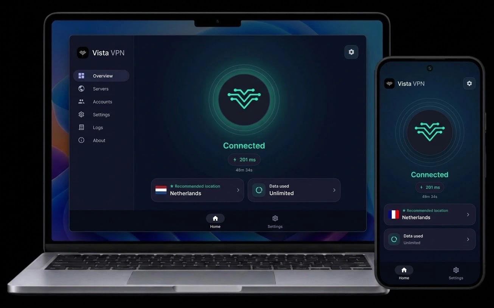
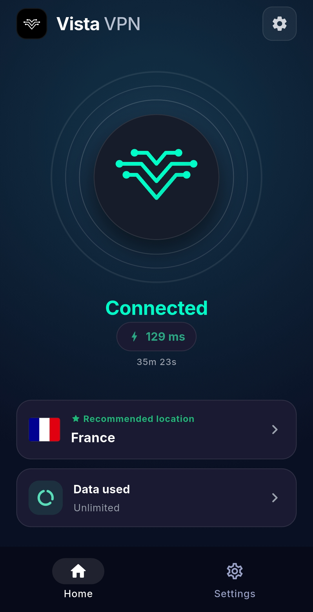
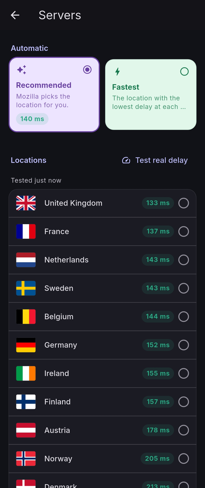
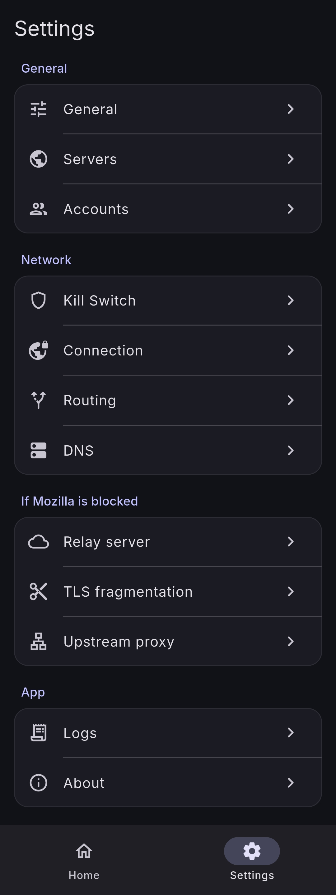
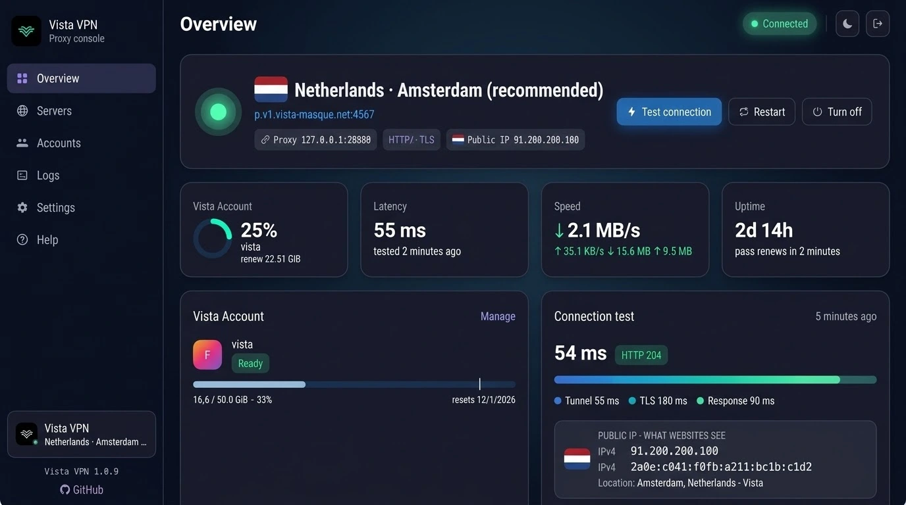

<div align="center">

[🇺🇸 English](../../README.md) &nbsp;/&nbsp; [🇮🇷 فارسی](README_fa.md) &nbsp;/&nbsp; [🇨🇳 简体中文](README_zh.md) &nbsp;/&nbsp; **🇷🇺 Русский**

</div>
<br>

<p align="center"></p>

<h1 align="center">Vista VPN</h1>

<h2 align="center">⚠️ Неофициальный проект</h2>

<h3 align="center">Vista VPN — независимый проект. Он не создан Mozilla, не принадлежит ей, не спонсируется и не одобрен ею и никак не связан с Mozilla. См. <a href="#отказ-от-ответственности">отказ от ответственности</a>.</h3>

<div align="center">

[](https://github.com/thisisvista/vista-vpn/releases)
[](https://github.com/thisisvista/vista-vpn/releases/latest)
[](../../LICENSE)

</div>

## Что такое Vista VPN?

**Vista VPN** — независимый VPN-клиент с открытым исходным кодом для аккаунтов Firefox. Он направляет трафик через VPN-серверы Mozilla на инфраструктуре **Fastly**, используя туннели **HTTP/1.1, HTTP/2 и HTTP/3**.

Для **Android, Windows, macOS и Linux**; полностью бесплатно, без рекламы.

<p align="center"><a href="https://raw.githubusercontent.com/thisisvista/vista-vpn/main/docs/screenshots/main.webp" target="_blank"></a></p>

## Возможности

- **Несколько платформ:** Android, Windows, macOS и Linux.
- **Поддержка Android TV:** управление с помощью пульта.
- **Понятный интерфейс:** основные элементы управления подключением собраны в одном месте.
- **Бесплатный трафик:** 50 ГБ в месяц для каждого аккаунта Firefox.
- **Выбор сервера:** выберите страну после проверки задержки или доверьте выбор Vista.
- **Протоколы подключения:** поддержка HTTP/1.1, HTTP/2 и HTTP/3.
- **Совместимость TLS с Firefox:** соединения с серверами Mozilla начинаются с TLS-отпечатка в стиле Firefox с помощью uTLS.
- **Раздельная маршрутизация:** укажите сайты и приложения, которые должны обходить VPN (Split Tunneling).
- **Для сетей с ограничениями:** фрагментация TLS, вышестоящий прокси SOCKS5 и [сервер-ретранслятор](../relay/README.md).
- **Резервная копия:** экспорт аккаунтов и настроек для переноса на другое устройство или сервер.
- **Параметры сети:** IPv4, IPv6, двойной стек и настраиваемый MTU.
- **Зашифрованный DNS:** поддержка DNS over HTTPS.
- **Локализация:** 15 языков, включая русский, английский, персидский и китайский.
- **Оформление:** светлая и тёмная темы.
- **Открытый исходный код:** код проекта доступен для изучения и участия в разработке.
- **Обновления:** поддержка автоматического обновления.

## Скриншоты

<p align="center">
&nbsp;&nbsp;
&nbsp;&nbsp;

</p>

## Загрузка

<table>
<thead>
<tr><th>Система</th><th>Скачать</th></tr>
</thead>
<tbody>
<tr><td>Android</td><td><a href="https://github.com/thisisvista/vista-vpn/releases/latest/download/Vista-VPN-Android-universal.apk"></a><br><a href="https://github.com/thisisvista/vista-vpn/releases/latest/download/Vista-VPN-Android-arm64-v8a.apk"></a><br><a href="https://github.com/thisisvista/vista-vpn/releases/latest/download/Vista-VPN-Android-armeabi-v7a.apk"></a><br><a href="https://github.com/thisisvista/vista-vpn/releases/latest/download/Vista-VPN-Android-x86_64.apk"></a></td></tr>
<tr><td>Android TV</td><td><a href="https://github.com/thisisvista/vista-vpn/releases/latest/download/Vista-VPN-Android-universal.apk"></a></td></tr>
<tr><td>Windows</td><td><a href="https://github.com/thisisvista/vista-vpn/releases/latest/download/Vista-VPN-Windows-Setup-x64.exe"></a><br><a href="https://github.com/thisisvista/vista-vpn/releases/latest/download/Vista-VPN-Windows-x64.zip"></a></td></tr>
<tr><td>macOS</td><td><a href="https://github.com/thisisvista/vista-vpn/releases/latest/download/Vista-VPN-macOS.dmg"></a></td></tr>
<tr><td rowspan="2">Linux</td><td><a href="https://github.com/thisisvista/vista-vpn/releases/latest/download/Vista-VPN-Linux-amd64.tar.gz"></a><br><a href="https://github.com/thisisvista/vista-vpn/releases/latest/download/Vista-VPN-Linux-arm64.tar.gz"></a></td></tr>
<tr><td><a href="https://github.com/thisisvista/vista-vpn/releases/latest/download/vista-vpn-core-linux-amd64.tar.gz"></a><br><a href="https://github.com/thisisvista/vista-vpn/releases/latest/download/vista-vpn-core-linux-arm64.tar.gz"></a></td></tr>
</tbody>
</table>

**Какой файл скачать?**

- **Android:** если не уверены, берите **Universal** — он устанавливается на любой телефон. **ARMv8** подходит для большинства современных телефонов и весит меньше.
- **Windows:** **Setup** — обычный установщик; **Portable** работает без установки из любой папки.
- **Linux:** **App** — для Linux с рабочим столом (с графической средой); **Core** — для сервера (без графической среды, с веб-панелью).

## Установка в Linux и macOS

> Пользователям Windows и Android этот раздел не нужен: возьмите установочный файл из таблицы «Скачать» выше.

```bash
curl -fsSL https://raw.githubusercontent.com/thisisvista/vista-vpn/main/install.sh | bash
```

### Веб-панель

Для серверов Linux у Vista VPN есть **веб-панель**, которая открывается в любом браузере и умеет всё, что умеет приложение: управление аккаунтами и трафиком, выбор сервера и проверка задержки, проверка соединения, живой журнал и все настройки.

<p align="center"></p>

- **Адрес панели:** `http://SERVER-IP:10820/app/`, с именем пользователя и паролем. Точный адрес показывается в конце установки.
- **Прокси:** SOCKS5 и HTTP на порту `10810`, с отдельными именем пользователя и паролем.

### Управление из терминала

На сервере выполните `sudo vista-vpn`, чтобы открыть меню управления:

```text
$ sudo vista-vpn

  Vista VPN
  ────────────────────────────────────────────────────────────────────────────
    Service     ● running
    Autostart   on
  ────────────────────────────────────────────────────────────────────────────
   0) Exit
  ────────────────────────────────────────────────────────────────────────────
   1) Update                                   vista-vpn update
   2) Uninstall                                vista-vpn uninstall
  ────────────────────────────────────────────────────────────────────────────
   3) Set panel login                          vista-vpn panel
   4) View panel info                          vista-vpn panel-info
  ────────────────────────────────────────────────────────────────────────────
   5) Status                                   vista-vpn status
   6) Start                                    vista-vpn start
   7) Stop                                     vista-vpn stop
   8) Restart                                  vista-vpn restart
   9) Show the log                             vista-vpn logs
  ────────────────────────────────────────────────────────────────────────────
  10) Enable autostart                         vista-vpn enable
  11) Disable autostart                        vista-vpn disable
  ────────────────────────────────────────────────────────────────────────────
  12) Add a Firefox Account                    vista-vpn add-account
  13) List the accounts                        vista-vpn list-accounts
  ────────────────────────────────────────────────────────────────────────────
  Enter a number [0-13]:
```

## Роутеры OpenWrt

Чтобы установить на роутер OpenWrt, см. [руководство по OpenWrt](../OPENWRT.md).

## Отказ от ответственности

Это приложение — независимый неофициальный клиент, который создаёт и поддерживает его собственный разработчик. Это не продукт Mozilla: Mozilla его не создавала, не владеет им, не спонсирует и не одобряет его и не участвует в его разработке и поддержке. С вопросами и проблемами приложения обращайтесь в этот репозиторий, а не в Mozilla.

Вы входите со своим собственным аккаунтом Mozilla. Условия, лимит трафика и доступность аккаунта определяет Mozilla. Ваш пароль и токены входа остаются на вашем устройстве.
